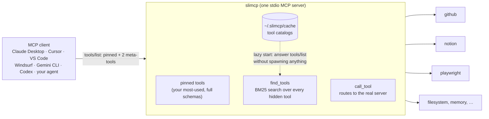

<div align="center">

<h1>slimcp</h1>

**Cut MCP tool token usage by 90%+ — an MCP proxy and context-window audit for Claude Desktop, Claude Code, Cursor, VS Code, Windsurf, Gemini CLI and Codex**

[](https://www.npmjs.com/package/slimcp)
[](https://www.npmjs.com/package/slimcp)
[](https://github.com/alperensarikavak/slimcp/actions/workflows/ci.yml)
[](LICENSE)
[](https://modelcontextprotocol.io)
[](CONTRIBUTING.md)

<sub>Listed on <a href="https://glama.ai/mcp/servers/alperensarikavak/slimcp">Glama</a></sub>


</div>

Six popular MCP servers put **111 tool definitions — 28,307 tokens — into every single request**, before you type a word.
Behind slimcp the same 111 tools cost **719 tokens (−97%)**, and the model still finds and calls every one of them.
Find out what your setup costs in 30 seconds:

```bash
npx slimcp audit
```

No install, no account, no network calls of its own. **Nothing changes until you run `npx slimcp init --yes`** — and `npx slimcp restore` undoes it.

---

- [Why](#why)
- [Benchmark](#benchmark)
- [How it works](#how-it-works)
- [Commands](#commands)
- [Configuration](#configuration)
- [Client setup](#client-setup)
- [Comparison](#comparison)
- [FAQ](#faq)
- [Roadmap](#roadmap)

## Why

MCP clients send the name, description and full JSON schema of **every tool of every connected server** to the model **on every request**. A few servers is enough to spend 10–50% of a context window on tool definitions the model will not use in this turn. That costs money, slows responses, crowds out your actual code and conversation, and makes tool selection *worse* as the list grows.

This is well documented:

- Anthropic, [*Code execution with MCP*](https://www.anthropic.com/engineering/code-execution-with-mcp) — why loading every tool definition up front wastes context and slows agents down.
- Anthropic, [*Advanced tool use*](https://www.anthropic.com/engineering/advanced-tool-use) and the [tool search tool](https://docs.claude.com/en/docs/agents-and-tools/tool-use/tool-search-tool) — deferring tool definitions and searching for them on demand.
- Cursor, [*Dynamic context discovery*](https://cursor.com/blog/dynamic-context-discovery) — loading MCP tools only when they are needed.
- Claude Code's [MCP docs](https://code.claude.com/docs/en/mcp) — built-in tool search for MCP servers.

Some clients now defer tools natively. **Many still load everything up front** — Claude Desktop, Gemini CLI, Windsurf, VS Code, Codex, most local-model setups and most custom agents. slimcp gives all of them the same trick, and tells you exactly where you stand.

## Benchmark

Real servers, tools/list only, o200k tokenizer, slimcp defaults ([full report](docs/benchmark.md)):

| server | tools | normal tokens | slimcp tokens | saved |
|---|---:|---:|---:|---:|
| github | 26 | 3,546 | 320 | −91% |
| notion | 24 | 17,140 | 354 | −98% |
| playwright | 25 | 3,921 | 315 | −92% |
| filesystem | 14 | 1,678 | 268 | −84% |
| memory | 9 | 947 | 251 | −73% |
| everything | 13 | 1,075 | 280 | −74% |
| **All together** | **111** | **28,307** | **719** | **−97%** |

**Search accuracy.** 40 natural-language requests ("merge the PR", "take a screenshot of the page", "rename a file", …) searched across all 111 tools at once:

| top-1 | top-3 | top-5 |
|---:|---:|---:|
| 68% | 85% | 93% |

That is plain BM25 with stemming and a small synonym table — no embeddings, no network. The misses are listed in [docs/benchmark.md](docs/benchmark.md). The model sees the top 5 by default, and the tools you actually use get [pinned](#configuration) so they skip the search entirely.

Reproduce it:

```bash
git clone https://github.com/alperensarikavak/slimcp && cd slimcp
npm install && npm run bench
```

## How it works



1. Your client starts **one** server — slimcp — instead of many.
2. `tools/list` returns your **pinned tools** (full schemas) plus two meta-tools:
   - **`find_tools`** — its description lists every hidden tool name, grouped by server, and tells the model to search *before* saying something is impossible. A search returns the best matches with compact schemas.
   - **`call_tool`** — runs a hidden tool by id (`github__create_issue`) with its arguments.
3. **Lazy start**: catalogs are cached in `~/.slimcp/cache`, so slimcp answers `initialize` + `tools/list` in about half a second (including its own startup) without spawning a single server. A server starts the first time one of its tools is actually called.
4. **Auto-pinning**: slimcp counts calls locally; your top 5 tools are pinned automatically next session, so everyday tools need no search.
5. **Output caps**: a tool that returns 50,000 words is cut to 12,000 tokens with a note asking the model for a narrower result.
6. **Clean shutdown**: when the client goes away (stdin closes, SIGINT/SIGTERM/SIGHUP), every child server is closed — no orphaned processes.

## Commands

| command | what it does |
|---|---|
| `npx slimcp audit` | Read-only. Finds every MCP config on this machine, starts each server once, lists its tools and grades each client A–F by the share of a 200K window it spends. Detects when Claude Code's tool search is silently off. |
| `npx slimcp init` | Dry run: shows which servers move where. `--yes` applies it, with backups. |
| `npx slimcp restore` | Copies back the original config files (the oldest backup of each). |
| `npx slimcp serve --config FILE` | The proxy itself, over stdio. This is what your client launches. |
| `npx slimcp wrap -- <cmd…>` | Proxy one server given on the command line, no config file. |
| `npx slimcp stats` | Your most-used tools; the top 5 are the auto-pinned ones. |

```bash
npx slimcp audit                         # all clients
npx slimcp audit --client claude-desktop # one client
npx slimcp audit --cached                # offline: reuse cached tool lists
npx slimcp audit --window 128k           # grade against a smaller window (local models)
npx slimcp audit --markdown > audit.md   # shareable report with badges
npx slimcp audit --json                  # machine-readable

npx slimcp init                          # preview
npx slimcp init --yes                    # apply (backs up every file first)
npx slimcp init --yes --keep github      # leave some servers where they are
npx slimcp init --yes --project          # also wrap ./.mcp.json, ./.vscode/mcp.json, …
npx slimcp restore                       # undo

npx slimcp wrap --name gh -- npx -y @modelcontextprotocol/server-github
npx slimcp stats
```

What `init --yes` does, per client config file:

1. Copies it to `<file>.slimcp-backup-<timestamp>` (mode 0600) and records it in `~/.slimcp/backups.json`.
2. Moves the servers' **raw** config (command, args, env, headers) into `~/.slimcp/<client>-<scope>.json` (mode 0600).
3. Puts a single `slimcp` entry in their place, pinned to the exact slimcp version you ran (never `@latest`).
4. Keeps every other key in the file untouched (`~/.claude.json` holds a lot of other state).

It skips clients that already defer tools natively (name them with `--client` to wrap them anyway), project configs unless `--project`, Claude Code's private local scope, disabled servers and servers that need VS Code `${input:…}` prompts. Codex's TOML is never rewritten: you get a snippet to paste. Quit Claude Code before applying — it rewrites `~/.claude.json` while running. JSONC comments (VS Code) are lost in the rewritten file; the backup keeps them.

## Configuration

A slimcp config is a JSON (or JSONC) file: your servers in any client's format, plus options.

```jsonc
{
  "servers": {
    "github": {
      "command": "npx",
      "args": ["-y", "@modelcontextprotocol/server-github"],
      "env": { "GITHUB_PERSONAL_ACCESS_TOKEN": "${GITHUB_TOKEN}" }
    },
    "notion": { "command": "npx", "args": ["-y", "@notionhq/notion-mcp-server"] },
    "linear": { "url": "https://mcp.linear.app/mcp", "headers": { "Authorization": "Bearer ${LINEAR_KEY}" } }
  },
  "pin": ["auto", "github__create_pull_request", "notion__*"],
  "autoPin": 5,
  "minify": "safe",
  "maxResultTokens": 12000
}
```

| option | default | meaning |
|---|---|---|
| `servers` / `mcpServers` | — | Server map. Accepts `command/args/env/cwd`, `url`, `serverUrl` (Windsurf), `httpUrl` (Gemini), `type: stdio\|http\|sse\|streamable-http`, `headers` / `http_headers`, `disabled: true`, `enabled: false`. `${VAR}`, `${VAR:-default}` and `${env:VAR}` are expanded. |
| `pin` | `["auto"]` | Tools exposed directly with full schemas: an exact id (`github__create_issue`), a whole server (`github__*`), any prefix ending in `*`, or `"auto"`. |
| `autoPin` | `5` | How many of your most-used tools `"auto"` pins. |
| `minify` | `"safe"` | `off`, `safe` (drop `$schema`, `title`, `$comment`, … and collapse whitespace) or `aggressive` (also first-sentence descriptions, no `examples`). Parameter names are never touched. |
| `maxResultTokens` | `12000` | Cap on text returned by one tool call. `0` disables it. |
| `searchLimit` | `5` | Default number of `find_tools` results (the model may ask for up to 25). |
| `catalog` | `"names"` | What `find_tools` lists in its description: every hidden tool name (`names`) or just server names with counts (`servers`, smaller for huge setups). |
| `eager` | `false` | Connect to every server at startup instead of answering from the cache. |
| `allowDestructiveViaCallTool` | `false` | Let `call_tool` run tools annotated `destructiveHint: true`. See [safety](#is-it-safe-does-it-send-my-data-anywhere). |

State lives in `~/.slimcp` (override with `SLIMCP_HOME`): configs, `cache/`, `usage.json`, `backups.json`.

## Client setup

`npx slimcp init --yes` does this for you. To do it by hand, point your client at one slimcp entry:

<details open>
<summary><b>Claude Desktop</b> — <code>claude_desktop_config.json</code></summary>

```json
{
  "mcpServers": {
    "slimcp": { "command": "npx", "args": ["-y", "slimcp", "serve", "--config", "/Users/you/.slimcp/config.json"] }
  }
}
```
On Windows use `"command": "cmd", "args": ["/c", "npx", "-y", "slimcp", "serve", "--config", "C:\\Users\\you\\.slimcp\\config.json"]`.
</details>

<details>
<summary><b>Cursor</b> — <code>~/.cursor/mcp.json</code></summary>

```json
{ "mcpServers": { "slimcp": { "command": "npx", "args": ["-y", "slimcp", "serve", "--config", "/Users/you/.slimcp/config.json"] } } }
```
Cursor already loads MCP tools on demand, so you mostly want slimcp here for output caps and the destructive gate.
</details>

<details>
<summary><b>VS Code</b> — <code>mcp.json</code></summary>

```json
{ "servers": { "slimcp": { "type": "stdio", "command": "npx", "args": ["-y", "slimcp", "serve", "--config", "/Users/you/.slimcp/config.json"] } } }
```
</details>

<details>
<summary><b>Windsurf</b> — <code>~/.codeium/windsurf/mcp_config.json</code></summary>

```json
{ "mcpServers": { "slimcp": { "command": "npx", "args": ["-y", "slimcp", "serve", "--config", "/Users/you/.slimcp/config.json"] } } }
```
</details>

<details>
<summary><b>Gemini CLI</b> — <code>~/.gemini/settings.json</code></summary>

```json
{ "mcpServers": { "slimcp": { "command": "npx", "args": ["-y", "slimcp", "serve", "--config", "/Users/you/.slimcp/config.json"] } } }
```
</details>

<details>
<summary><b>Codex CLI</b> — <code>~/.codex/config.toml</code></summary>

```toml
[mcp_servers.slimcp]
command = "npx"
args = ["-y", "slimcp", "serve", "--config", "/Users/you/.slimcp/config.json"]
```
</details>

<details>
<summary><b>Claude Code</b></summary>

```bash
claude mcp add slimcp -- npx -y slimcp serve --config ~/.slimcp/config.json
```
Claude Code's own tool search usually makes this unnecessary — see the [FAQ](#does-claude-code-need-this).
</details>

<details>
<summary><b>Your own agent</b> (library API)</summary>

```ts
import { SlimProxy, resolveConfig } from "slimcp";

const proxy = new SlimProxy(
  resolveConfig({
    servers: { github: { command: "npx", args: ["-y", "@modelcontextprotocol/server-github"] } },
    pin: ["auto", "github__create_issue"],
  }),
);
await proxy.init();

const tools = proxy.currentExposure.tools;                 // send these to your model
const result = await proxy.handleCall("find_tools", { query: "merge a pull request" });
// …then proxy.handleCall("call_tool", { name: "github__merge_pull_request", arguments: {...} })
await proxy.close();                                       // closes every child server
```
Or expose it to any MCP client: `await proxy.server.connect(transport)`.
</details>

Pin the version (`slimcp@0.1.0`) if you want reproducible setups — `init` always does.

## Comparison

| | Do nothing | Client-native deferral<br/>(Claude Code tool search, Cursor) | Other lazy proxies<br/>(lazy-mcp, mcp-lazy-proxy, …) | **slimcp** |
|---|:-:|:-:|:-:|:-:|
| Saves context in clients that load everything up front | — | — (only in that client) | ✅ | ✅ |
| Works with any MCP client and custom agents | ✅ | — | ✅ | ✅ |
| Per-client audit with tokens, % of window and a grade | — | — | — | ✅ |
| Tells you when Claude Code's tool search is off | — | — | — | ✅ |
| One-command setup with backups and `restore` | — | built in | varies | ✅ |
| Auto-pins your most-used tools | — | — | varies | ✅ |
| Caps huge tool outputs | — | varies | varies | ✅ |
| Blocks destructive tools behind the meta-tool | n/a | n/a | varies | ✅ |
| Extra moving part | none | none | yes | yes |

If your client already defers tools natively and you are happy with it, keep using that. The proxies listed are good projects with similar ideas — check their docs for their exact features: [voicetreelab/lazy-mcp](https://github.com/voicetreelab/lazy-mcp), [mcp-lazy-proxy](https://www.npmjs.com/package/mcp-lazy-proxy) and lazy-mcp on GitLab.

## FAQ

### How do I reduce MCP token usage?

Run `npx slimcp audit` to see which client and which server costs the most. Then either remove servers you do not use, or run `npx slimcp init --yes` so the client sees a handful of pinned tools plus `find_tools`/`call_tool` instead of every schema. In the benchmark that is 28,307 → 719 tokens per request.

### Why is my Claude context full of MCP tools?

Because MCP clients send every connected server's tool names, descriptions and JSON schemas with every request so the model knows what it can call. One server like Notion's is ~17,000 tokens on its own. Claude Desktop sends all of them up front; `npx slimcp audit` shows you the bill per server and the heaviest individual tools.

### Does Claude Code need this?

Usually not. Claude Code has built-in **tool search**, on by default, which already defers MCP tools. The audit is still useful: it shows your token bill and warns you when tool search is **off** — which happens with `ENABLE_TOOL_SEARCH=false` or `auto:100`, with a truthy `CLAUDE_CODE_DISABLE_EXPERIMENTAL_BETAS`, or when `ANTHROPIC_BASE_URL` points at a non-Anthropic gateway (LiteLLM, a corporate proxy, …). `ENABLE_TOOL_SEARCH=auto` / `auto:N` defers only above a threshold. If a gateway has turned tool search off for you, the slimcp proxy brings the savings back. `init` skips Claude Code unless you name it with `--client claude-code`.

### Does it hurt tool-calling accuracy?

It adds one step — the model searches, then calls — and search is not perfect: 68% top-1, 85% top-3 and 93% top-5 on our 40-query benchmark, and the model sees 5 results by default. Three things keep this from hurting in practice: `find_tools` lists every hidden tool *name* so the model knows what exists, the tools you use most are auto-pinned (full schemas, no search), and you can pin anything explicitly (`"pin": ["github__*"]`). Fewer tools in context also tends to *improve* selection on large setups. If a workflow depends on exact tool choice, pin those tools.

### Is it safe? Does it send my data anywhere?

- **Local only.** slimcp makes no network requests of its own: no telemetry, no update checks, no embeddings API. It talks only to the servers you already configured.
- **No logging of your data.** Tool arguments and results are never logged; stderr shows only server names, counts and errors.
- **Secrets stay private.** Moved server configs (which may contain tokens) and backups are written with mode 0600 in a 0700 `~/.slimcp`.
- **Reversible.** Every changed file is backed up first; `npx slimcp restore` puts the originals back byte for byte.
- **The approval trade-off, honestly.** Clients ask for approval per tool name. Behind slimcp, hidden tools run through `call_tool`, so a client that auto-approves `call_tool` would auto-approve everything behind it. That is why slimcp never marks `call_tool` as read-only, and why **destructive tools are gated**: a hidden tool annotated `destructiveHint: true` is refused by `call_tool` with instructions to pin it. Once pinned it appears under its own name and your client asks before each call. Servers that do not annotate their tools are not detected — pin tools you want your client to approve individually.
- Releases are published from CI with [npm provenance](https://docs.npmjs.com/generating-provenance-statements). See [SECURITY.md](SECURITY.md).

### Which clients does the audit find?

Claude Code (`~/.claude.json` user and local scopes, `./.mcp.json`), Claude Desktop, Cursor (user and project), VS Code (user and `./.vscode/mcp.json`), Windsurf, Gemini CLI (user and project) and Codex CLI (`$CODEX_HOME/config.toml`). Missing one? [Open an issue](https://github.com/alperensarikavak/slimcp/issues/new?template=add-client.yml).

### How are tokens counted?

With the o200k_base tokenizer over `{name, description, input_schema}` of each tool. Claude, Gemini and local models tokenize differently and clients add framing, so absolute numbers are approximate; the relative saving holds.

## Roadmap

- Resources and prompts passthrough
- Optional local embeddings search
- HTTP (streamable) server mode
- Per-project profiles
- VS Code extension

Ideas and PRs welcome — see [CONTRIBUTING.md](CONTRIBUTING.md).

## Contributing

`npm install && npm test`. Adding a client is one entry in [`src/discover.ts`](src/discover.ts); adding benchmark queries is one line in [`scripts/benchmark.mjs`](scripts/benchmark.mjs). Details in [CONTRIBUTING.md](CONTRIBUTING.md).

## License

[MIT](LICENSE)

---

<div align="center">

**⭐ Star if it saved you tokens**

[](https://star-history.com/#alperensarikavak/slimcp&Date)

</div>
